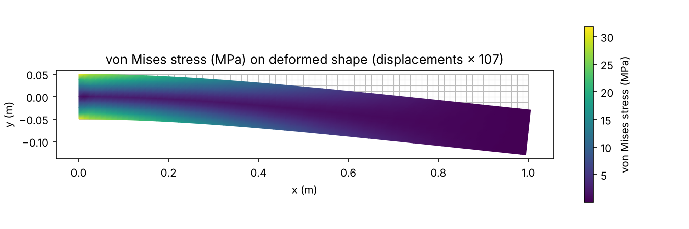
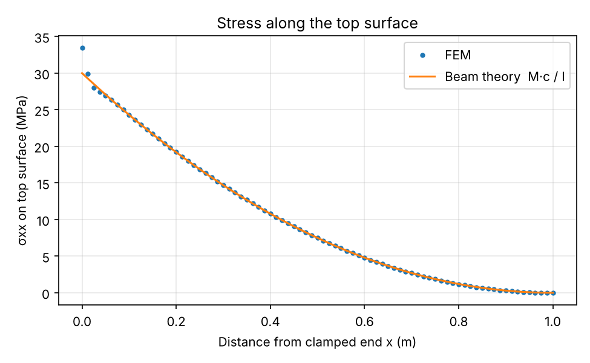
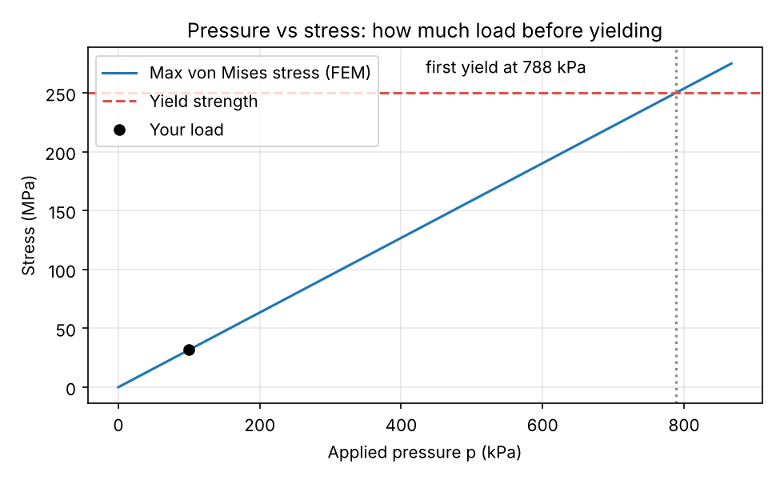

---
---

FEM-2D is a two-dimensional plane-stress finite element solver written from
scratch in Python (NumPy only, no finite element library) that runs entirely
in the web browser. The user selects a material, applies a pressure to a
clamped bar, and obtains the stress and strain fields, the deflection, a
pressure–stress curve and a safety factor against yield. The results are
verified against beam theory; the Q4 solution agrees to within 1%.

[Live demo](https://arbhadra.github.io/fem2d-web/) ·
[Source code](https://github.com/arbhadra/fem2d-web)

## Problem statement

A rectangular bar of length $L$, height $h$ and thickness $t$ is clamped at
one end. A uniform pressure $p$ acts either on its top face (bending) or on
its free end (tension). Small strains, linear elasticity and plane stress are
assumed. Material presets cover structural steel A36, stainless steel 304,
aluminium 6061-T6, Ti-6Al-4V, and 3D-printed PLA and ABS; custom values of
$E$, $\nu$ and yield strength may also be entered.

## Method

The equilibrium equation $\nabla\cdot\boldsymbol{\sigma} = 0$ is multiplied by
a virtual displacement and integrated by parts, giving the principle of
virtual work, which requires only first derivatives of displacement. Within
each element the displacement is interpolated from nodal values,
$\mathbf{u} = \mathbf{N}\mathbf{u}_e$, so that $\boldsymbol{\varepsilon} =
\mathbf{B}\mathbf{u}_e$ and $\boldsymbol{\sigma} = \mathbf{D}\boldsymbol{\varepsilon}$.
The element stiffness matrix is

$$
\mathbf{k}_e = \int_{A_e} \mathbf{B}^{T}\mathbf{D}\mathbf{B}\, t \, dA .
$$

Element matrices are assembled into the global system $\mathbf{K}\mathbf{u} =
\mathbf{F}$ with consistent pressure loads, and the system is solved by
partitioning out the clamped degrees of freedom; reactions are then
recovered. Two element formulations are implemented:

- **CST** (constant-strain triangle): linear shape functions; the stiffness
  matrix is exact in closed form.
- **Q4** (isoparametric 4-node quadrilateral): mapped from a reference square
  through the Jacobian $\mathbf{J}$ and integrated with 2×2 Gauss quadrature.

Post-processing comprises nodal strain and stress recovery, the von Mises
stress, and the safety factor $SF = \sigma_y / \max \sigma_{vM}$. Because the
problem is linear, first yield occurs at a pressure of $p \times SF$.

The reference solution for the bending case uses Timoshenko beam theory with
line load $q = p\,t$:

$$
\delta_{tip} = \frac{qL^4}{8EI} + \frac{qL^2}{2\kappa G A}, \qquad
\sigma_{xx} = \frac{M(x)\,c}{I}, \quad M(x) = \frac{q(L-x)^2}{2}.
$$

The front end is built with PyScript, so the code exercised by continuous
integration is the same code executed in the visitor's browser.

## Verification

Fifteen automated tests run on GitHub Actions. They cover the constitutive
matrix $\mathbf{D}$, rigid-body and hourglass modes, a patch test on a
distorted mesh, global equilibrium, the tension case against
$\varepsilon = p/E$, convergence to beam theory, linear scaling with load, and
website start-up.

The benchmark case is a steel A36 bar with $L = 1$ m, $h = 0.1$ m,
$t = 0.01$ m and $p = 100$ kPa on the top face ($\kappa = 5/6$).

| Quantity | FEM | Beam theory | Difference |
|---|---|---|---|
| Tip deflection, Q4 40 × 4 | 0.734 mm | 0.758 mm | −3.1% |
| Tip deflection, Q4 80 × 8 | 0.751 mm | 0.758 mm | −0.9% |
| Tip deflection, CST 80 × 8 | 0.718 mm | 0.758 mm | −5.2% |
| $\sigma_{xx}$, top surface, mid-span, Q4 80 × 8 | 7.50 MPa | 7.50 MPa | 0.0% |
| Sum of reactions | 1000 N | 1000 N ($p L t$) | machine precision |

<figure>
  
  <figcaption>Figure 1: von Mises stress on the deformed bar (displacements magnified).</figcaption>
</figure>

<figure>
  
  <figcaption>Figure 2: Normal stress along the top surface, FEM compared with beam theory M·c/I.</figcaption>
</figure>

## Findings

- **Element locking.** Linear triangles are overly stiff in bending: on the
  same 80 × 8 mesh, the tip-deflection error is 5.2% for CST against 0.9% for
  Q4.
- **Stress singularity.** The peak stress at the clamped corner increases with
  mesh refinement (26.8 → 29.3 → 31.7 MPa). A safety factor based on this
  value is therefore mesh-dependent and is reported with that caveat.
- **Stiffness and strength.** Under the same pressure, PLA deflects about 57
  times more than steel, while its yield strength is only about 5 times lower.

<figure>
  
  <figcaption>Figure 3: Applied pressure against peak von Mises stress; first yield occurs at about 790 kPa.</figcaption>
</figure>

## Usage notes

On first visit, Python, NumPy and Matplotlib are loaded into the browser,
which takes about 15–30 s; subsequent solves take about one second. The model
size is limited to about 2,000 degrees of freedom (for example, an 80 × 10
mesh).
